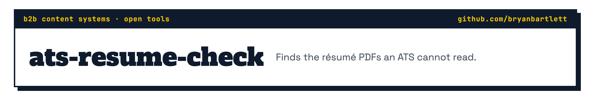

<picture>
  <source media="(prefers-color-scheme: dark)" srcset=".github/assets/header-ats-resume-check-dark.png">
  
</picture>

[](https://github.com/bryanbartlett/ats-resume-check/actions/workflows/tests.yml)


Find out if an applicant tracking system can read your résumé, before you send it.

An ATS does not see your page. It reads the PDF's text layer. A résumé can look perfect and still reach the recruiter as one long run of letters, with no keywords to match. I found this the hard way: a variable font printed every word with no space after it, on résumés I had already sent.

This tool reads the text layer the way an ATS does and tells you what will go wrong.

```
$ python ats_resume_check.py resume.pdf
resume.pdf
  PASS  text layer: 612 words can be read
  FAIL  word spaces: 41 words run together (for example: Ledthecontentteamandshipped, ...)
  WARN  dates: dates show the year only (2019 – 2023). Some ATS (Workday among them) then guess January, or drop the job. Use month and year.
  PASS  contact: email and phone found
  WARN  headings: numbered headings such as '01 Experience'. Many parsers only know plain names: Experience, Education, Skills.
  WARN  fonts: Type 3 fonts: ABCDEF+Inter. These often lose the spaces between words. Variable fonts usually cause this; use the static font files.
```

## What it checks

| Check | What goes wrong |
|---|---|
| Text layer | The PDF is an image or a scan, so there is nothing to read. |
| Word spaces | Words run together, so no keyword matches. |
| Fonts | Type 3 fonts, the usual cause of lost spaces. |
| Dates | Year-only dates. Some parsers guess the month or drop the job. |
| Contact | No email or phone in the text layer (a common result of putting them in a header image). |
| Headings | Numbered or unusual section names that parsers do not map to Experience, Education and Skills. |

It exits with 1 when any check fails, so you can use it in a script before you upload.

## Install

Python 3.10 or later, no packages to install. It needs poppler for `pdftotext` and `pdffonts`:

```
brew install poppler          # macOS
sudo apt install poppler-utils  # Debian, Ubuntu
```

Then:

```
python ats_resume_check.py resume.pdf
python ats_resume_check.py --text resume.pdf   # also print what the ATS sees
```

## Limits

`pdftotext` stands in for a real ATS. Workday, Greenhouse and the others each use their own parser, so a clean result here lowers the risk; it does not remove it. Two-column layouts can still interleave in some parsers. When in doubt, send a one-column file.

MIT licence.

---

An open tool from **B2B Content Systems**, Bryan Bartlett, Boston, MA. More at [github.com/bryanbartlett](https://github.com/bryanbartlett) and [bryanbartlett.com](https://bryanbartlett.com).
